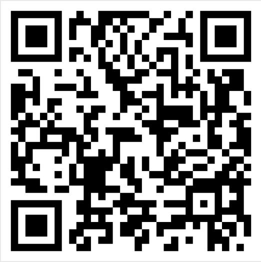
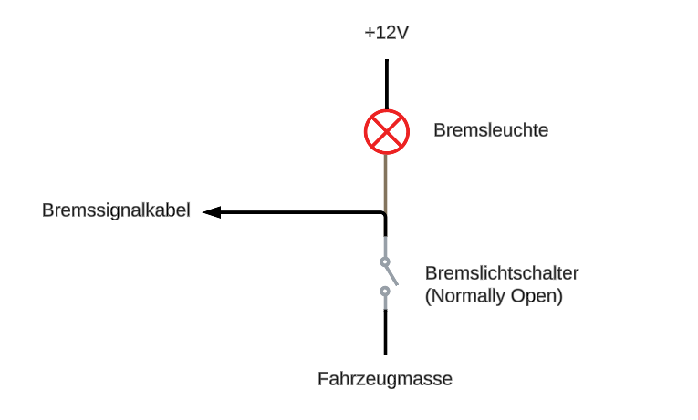

# Fehlerbehebung

Solltest du Probleme bei der Inbetriebnahme deines Umbausatzes haben, findest du unter folgendem Link Hilfe:

[second-ride.de/fehlerbehebung](https://www.second-ride.de/fehlerbehebung)

  

## Status LEDs Antriebsmodul

An der linken Seite des Antriebsmoduls befinden sich drei LEDs. Von links nach rechts haben sie folgende Bedeutung.

### LED 1: Systemstatus

| Leuchtmuster | Bedeutung |
|---|---|
| 🟢 Grün, dauerhaft an | Inaktiver Fahrzustand |
| 🟢 Grün, blinkt | Aktiver Fahrzustand |
| 🟣 Lila, dauerhaft an | Konfigurationsmodus aktiv |
| 🔵 Cyan, blinkt | Das Antriebsmodul aktualisiert gerade die Motorsteuerung, zum Beispiel nach einem Firmware-Update |

Eine gedrosselte Leistung im Fahrbetrieb wird nicht an LED 1 angezeigt, sondern an der LED des Tasters an der Armatur (siehe [Bedienung](../01-bedienung/index.md)). Eine betätigte Bremse (Motorabschaltung) wird an den Status LEDs nicht angezeigt.

### LED 2: Status der Drosselung

| Leuchtmuster | Bedeutung |
|---|---|
| 🟢 Grün, dauerhaft an | System ist legal gedrosselt (Drosselung endgültig gespeichert) |
| 🟠 Orange, dauerhaft an | System ist NICHT endgültig gedrosselt |
| Aus | Status ist noch nicht ermittelt, zum Beispiel direkt nach dem Einschalten |

### LED 3: Fehlercode

Liegt kein Fehler vor, ist LED 3 aus. Liegt ein Fehler oder eine Warnung vor, blinkt LED 3 einen Code aus einem Buchstaben und drei Ziffern, zum Beispiel `E402`. Das Muster wiederholt sich nach einer Pause von 3 Sekunden.

1. **Art der Meldung:** ein langes Blinken (ca. 1,5 s).
    - 🔴 Rot, einmal lang: Fehler (`E`)
    - 🔴 Rot, zweimal lang: schwerer Fehler (`F`)
    - 🟡 Gelb, einmal lang: Warnung (`A`)
2. **Ziffern:** Nach einer kurzen Pause folgt jede Ziffer als Gruppe kurzer Blinkzeichen in derselben Farbe. Die Anzahl der Blinkzeichen entspricht der Ziffer. Zwischen den Gruppen liegt eine kurze Pause.
    - Ist die mittlere Ziffer eine 0, wird sie ausgelassen. Du siehst dann nur zwei Gruppen.
    - Eine 0 an erster oder letzter Stelle wird als ein einzelnes, etwas längeres Blinken angezeigt.

Beispiel `E402`: einmal lang rot, Pause, viermal kurz, Pause, zweimal kurz, 3 Sekunden Pause.

Liegen mehrere Meldungen gleichzeitig vor, wird nur eine davon angezeigt. Fehler haben Vorrang vor Warnungen.

| Code | Blinkmuster nach dem langen Blinken | Bedeutung |
|---|---|---|
| `E201` | 🔴 2 x kurz, 1 x kurz | Die gespeicherte Konfiguration der Drosselung konnte nicht geladen werden oder ihre Prüfung ist fehlgeschlagen |
| `E301` | 🔴 3 x kurz, 1 x kurz | Das Antriebsmodul empfängt keine Statusmeldungen der Motorsteuerung |
| `E401` | 🔴 4 x kurz, 1 x kurz | Keine Verbindung zur Motorsteuerung |
| `E402` | 🔴 4 x kurz, 2 x kurz | Die Aktualisierung der Motorsteuerung ist fehlgeschlagen |
| `A101` | 🟡 1 x kurz, 1 x kurz | Der Systemstatus kann nicht ermittelt werden |
| `A201` | 🟡 2 x kurz, 1 x kurz | Die Konfiguration der Drosselung kann nicht vollständig geprüft werden |

Bleibt eine Meldung nach dem Aus- und Wiedereinschalten bestehen, notiere dir den Code und kontaktiere uns.

## Sonstige Tipps zur Fehlerbehebung

Falls dir das nicht weiterhilft, verfolge die Fehlerdiagnose im Folgenden.

**1. Weder die Ladestandsanzeige noch die Taster-LED geht an, wenn das Zündschloss betätigt wird.**

- Prüfe, ob die Steckverbindungen zwischen Zündschloss und Antriebsmodul, sowie Antriebsmodul und Akku richtig verbunden sind.
- Weiterhin könnte der Akku zu wenig Ladung haben oder die Temperatur des Akkus außerhalb von -20°C und 60°C sein. Sorge dann zuerst dafür, dass der Akku wieder Raumtemperatur annimmt (was einige Stunden dauern kann) und verbinde ihn dann mit dem Ladegerät.

**2. Keines der Bordnetz-Lichter geht an, wenn das neue Zündschloss betätigt wird, und das Simson-Zündschloss auf der Stellung des Scheinwerfer- bzw. "II"-Symbols ist.**

- Prüfe, ob alle elektrischen Steckverbindungen zwischen Antriebsmodul und Bordnetz richtig verbunden sind.
- Ist das nicht das Problem, liegt es wahrscheinlich an deinem Bordnetz. Entweder hast du einen Kurzschluss oder irgendwo ist eine Verbindung nicht richtig. Im Falle eines Kurzschlusses schaltet das Antriebsmodul die Spannung aus. Dann kannst du mit einem Spannungsmessgerät keine Spannung zwischen dem 12 V und Masse-Kabel messen.

**3. Die Lichter gehen an, die Taster-LED leuchtet durchgängig, aber es lässt sich kein Gas geben.**

- Möglicherweise erkennt dein Antriebsmodul eine betätigte Bremse und gibt den Motor deshalb nicht frei. Das wird an den Status LEDs nicht angezeigt.  
  Um das zu prüfen, verbinde eines der roten 12V Kabel des Bordnetzkabels mit dem Ende des mitgelieferten Bremssignalkabels. Dreht sich der Motor nun beim Gas geben, liegt der Fehler bei deinem Fahrzeug, siehe unten für weitere Diagnosen. Lässt sich weiterhin kein Gas geben, kontaktiere uns bitte.
- Leuchtet dein Bremslicht, obwohl du nicht bremst? Dann liegt der Fehler bei deinem Bremslichtschalter. Dein Bremslichtschalter ist falsch eingestellt und muss justiert werden, sodass er nur dann schaltet, wenn du tatsächlich die Bremse betätigst. Dafür gibt es bei einem externen Bremslichtschalter eine Einstellschraube. Bei einem innenliegenden Bremslichtschalter musst du das Hinterrad ausbauen und die Kontaktfahne so verbiegen, dass der Kontakt nur hergestellt wird, wenn du bremst.
- Ist das Bremssignalkabel richtig angeschlossen, wie in der Umbauanleitung im Kapitel *Montage des Umbaukits → Akkuhalterung* beschrieben?
- Prüfe, ob am Motorabschaltungskabel 12V anliegen, wenn das Fahrzeug eingeschaltet ist und die Bremse NICHT betätigt wird. Wenn keine 12V anliegen, hast du ein Problem mit der Simson Elektrik und das Antriebsmodul empfängt daher das Signal zum Bremsen. Zur Veranschaulichung der korrekten Schaltung des Bremssignalkabels / Motorabschaltungskabels:

  

- Wenn die vorherigen Punkte nicht zutreffen, dann befolge die Anleitung im Kapitel *Montage des Umbaukits → Gaszug*, um die Leerlaufstellung des Kolbenschiebers noch einmal richtig einzustellen.

**4. Die Kette schleift an der Schwinge oder die Kettenschläuche passen nicht.**

- Prüfe, ob deine Stoßdämpfer die originale Länge haben. Ist das nicht der Fall, kann durch die andere Position der Schwinge die Kette schleifen.
- Prüfe, ob du die originalen Kettenschläuche und Kettenkasten verwendest und ob die Schläuche korrekt auf dem Kettenkasten montiert sind.

**5. Der Legal Limit Konfigurator öffnet sich nicht automatisch nach Verbindung mit dem "Second Ride Legal Limits" WLAN.**

- **Mobile Daten deaktivieren:** Schalte mobile Daten (4G/5G) auf deinem Gerät aus, damit der gesamte Datenverkehr über das "Second Ride Legal Limits" WLAN läuft.
- **Kein anderes WLAN verbunden?** Stelle sicher, dass sich dein Gerät nicht automatisch mit einem anderen WLAN (z.B. deinem Heimnetzwerk) verbunden hat.
- **Konfigurator manuell öffnen:** Gib folgende Adresse in deinen Browser ein: `http://192.168.12.1`. Wichtig: Nutze `http://` (nicht `https://`). Falls dein Browser eine Sicherheitswarnung anzeigt, klicke auf „Weiter zur Seite" bzw. „Continue to site". Der Legal Limit Konfigurator sollte sich dann öffnen.

**6. Hilft das alles nichts, oder hast du ein ganz anderes Problem?**

Ruf uns an oder schreib in die Discord Gruppe (siehe Nützliche Links in der Umbauanleitung).

---

## Verlorene Schlüssel

Falls du deinen Zündschlüssel verlieren solltest, kannst du uns per E-Mail oder Discord kontaktieren. Wir benötigen dann nur die 3-stellige Nummer auf deinem Ersatzschlüssel.
